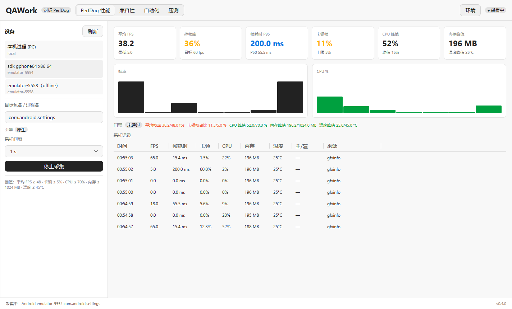
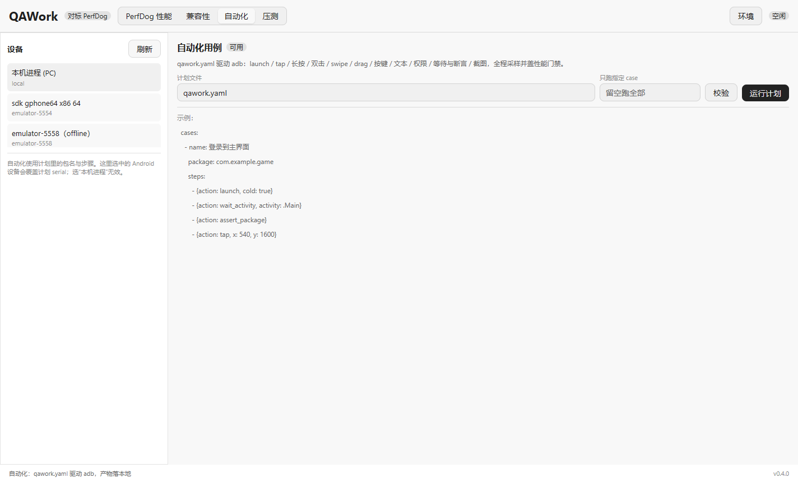
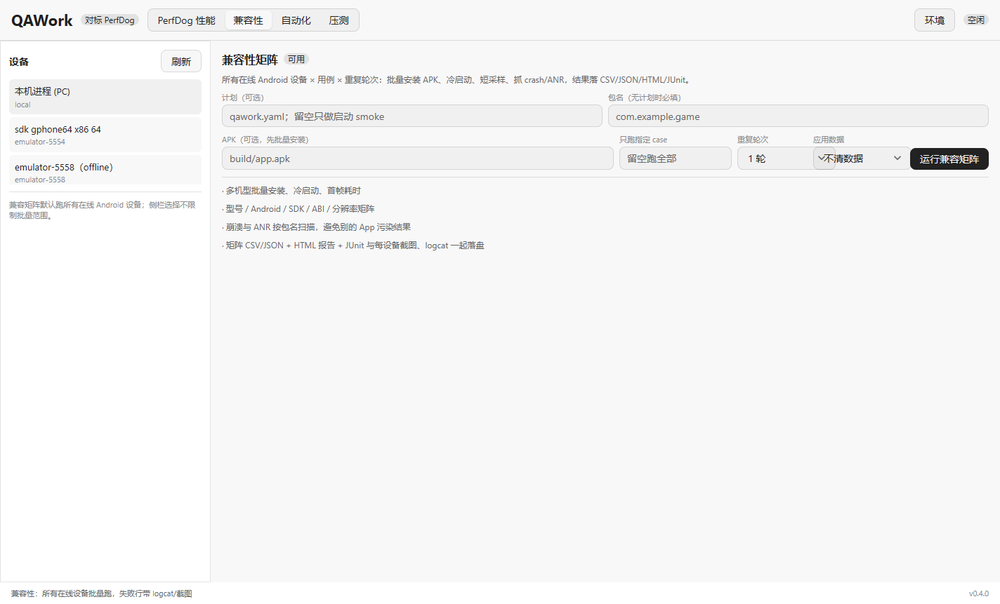
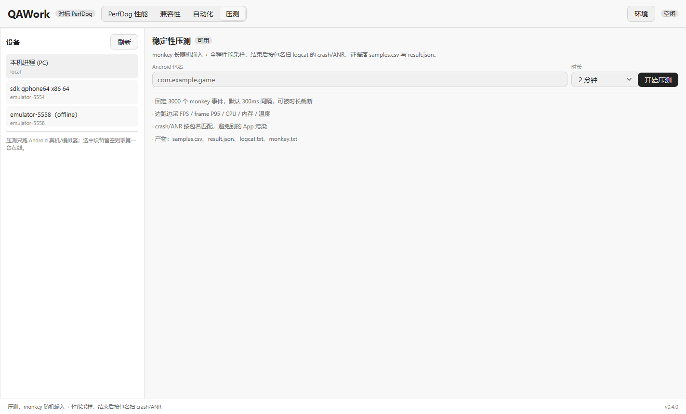
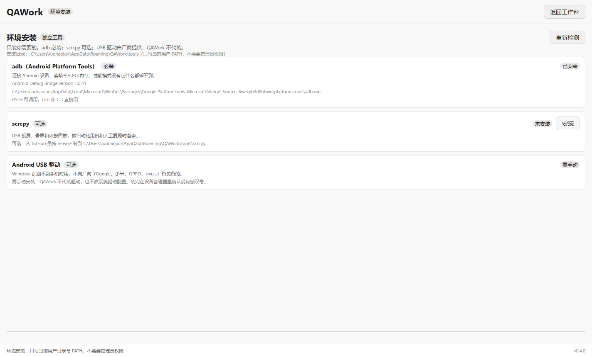

# QAWork

**把 QA 流程搬回本地**：Go 1.27 + MyGo（GPUI 思路的原生 GPU 桌面 UI）写的游戏 QA 工作台，无 WebView、无浏览器、纯 Go 零 CGO。
默认工作模式就是 **PerfDog 性能模式**：选设备、填包名、按固定间隔采帧率/CPU/内存/温度，跑完按阈值盖门禁。



## 为什么不是 PerfDog 的复制品

竞品很明确：[腾讯 PerfDog](https://wetest.qq.com/products/perfdog)——成熟、跨端、开箱即用的性能测试工具。QAWork 不和它拼功能数量，拼的是"能不能留在自己的流水线里"：

| 维度 | PerfDog（腾讯 WeTest 产品） | QAWork（本地工作台） |
| --- | --- | --- |
| 形态 | 桌面客户端 + 账号体系，云同步报告 | 开源原生窗口 + CLI，离线可用 |
| 平台 | Android / iOS 等多端，覆盖成熟 | Android + Windows/macOS 本机进程（CPU/内存），iOS 未接 |
| 数据 | 平台报告为主 | CSV/JSON/HTML/JUnit 落本地，直接进自己的脚本 |
| 自动化 | 客户端内报告与分析 | 退出码 2 的门禁，本地脚本/任意编排工具直接卡 |
| 二开 | 闭源 | 纯 Go，改采样器、接自有设备池 |
| 成本 | 免费额度 + 订阅，以官方为准 | 开源免费，硬件自己的 |

定位：**PerfDog 解决"拿来就能测"，QAWork 解决"测完能卡住发布"。** 短期不追它的平台覆盖，先把 Android 口径和本地门禁做扎实。

## 工作模式

当前四种模式都已接真实 adb 流程，不摆假数据：

| # | 模式 | 状态 | 说明 |
| --- | --- | --- | --- |
| 0 | **PerfDog 性能**（默认） | 可用 | 对标 [PerfDog](https://wetest.qq.com/products/perfdog) 的采集口径 |
| 1 | 兼容性 | 可用 | 所有在线设备 × 用例 × 重复轮次：批量安装/冷启/崩溃矩阵 |
| 2 | 自动化 | 可用 | `qawork.yaml` 用例 + adb 步骤/断言 + 性能门禁 |
| 3 | 压测 | 可用 | monkey 长随机输入 + 采样 + crash/ANR |

模式编号与默认值写死在 `internal/app`（`Mode` 默认 0），文档、UI、CLI 三处必须一致。

## 宿主平台

只支持两个宿主：**Windows x86（amd64）** 与 **macOS arm64**；当前开发机是 Windows 时只做 Windows 真实验证，macOS 做 arm64 交叉编译，有 Mac 时再补真机跑。Android 侧统一走 adb，不区分宿主。

**不使用 GitHub Actions**：没有 `.github/workflows`，验证与发布都在本机脚本里完成。

## 快速开始

需要 Go 1.27+，`CGO_ENABLED=0` 可直接构建。

```powershell
go build -o qawork-gui.exe .\cmd\qawork-gui   # 桌面工作台
go build -o qawork.exe .\cmd\qawork           # CLI
.\scripts\verify.ps1                          # 本地门禁：单测 + Windows 构建 + macOS arm64 交叉编译
.\qawork-gui.exe
```

自检渲染（不开窗口给人看，截首帧）：

```powershell
.\qawork-gui.exe -capture .\docs\shot.png
.\qawork-gui.exe -demo -capture .\docs\shot.png   # 采本机进程 8 秒后再截图
```

### CLI

```powershell
qawork devices                                   # 列 adb 设备
qawork device info -json                         # 型号/系统/ABI/分辨率/电量
qawork device start -package com.example.game -json   # 启动 + 耗时
qawork device logcat -lines 500                   # 最近日志
qawork setup check                               # 检查 adb / scrcpy / 驱动
qawork setup install -id adb                     # 必装；已装则跳过
qawork perf -serial 127.0.0.1:16384 -package com.example.game -duration 60s -csv run.csv
qawork perf -serial local -package Game.exe -duration 30s          # 本机进程（无帧率）
qawork report -csv run.csv -min-fps 50 -max-jank 5                 # 只汇总和判定
qawork run -plan qawork.yaml                     # 自动化：步骤回放 + 采样 + 门禁
qawork run -plan qawork.yaml -validate           # 只校验计划，不碰设备
qawork compat -plan qawork.yaml -apk app.apk -repeat 3 -reset      # 批量兼容 + 重复轮次
qawork stress -package com.example.game -duration 30m              # monkey 压测
qawork mcp                                                         # stdio MCP，给 Agent
```

`perf` / `run` / `compat` / `stress` / `report` 在门禁、兼容或压测失败时退出码 2，可直接当本地发布卡点。`-json` 输出机器可读结果。

### 自动化与兼容

`examples/qawork.yaml` 是可直接校验的示例。步骤支持 `launch`（仅第一步）/ `wait` / `tap` / `longpress` / `doubletap` / `swipe` / `drag` / `keyevent` / `text`（仅 ASCII）/ `stop` / `clear` / `grant` / `revoke` / `wait_activity` / `wait_text` / `assert_activity` / `assert_text` / `assert_not_text` / `assert_package` / `screenshot`；全程按 `interval` 采样，结束后按阈值盖门禁，失败自动留 `failure.png`。`wait_activity` / `assert_activity` 用 `activity:` 或 `text:` 指定目标；文本断言依赖 uiautomator accessibility tree，SurfaceView 游戏可能读不到。

兼容矩阵对每台在线设备、每个 case、每个重复轮次：可选装 APK → 可选 `pm clear` → 清 logcat → 跑同一 case → 扫 `FATAL EXCEPTION` / `ANR in <包名>` → 截屏；输出设备信息、启动耗时、FPS/CPU/内存、crash/ANR 到 `compat-matrix.csv/json`，并生成 `compat-report.html` 与 `compat-junit.xml`。没有计划时只做启动 smoke，不做性能判定。

压测固定 warm launch → `monkey -p <包名>` → 采样 → 读 logcat；输出 `samples.csv`、`result.json`、`logcat.txt`、`monkey.txt`。超时被杀的 monkey 不算错误，crash/ANR 按包名精确匹配。

口径、产物结构和已知边界见 [docs/automation.md](docs/automation.md)。







## Agent 原生：CLI / MCP

QAWork 从设计上就是给 Agent 用的，不只是给人点的窗口：

- **CLI**：`devices`、`device info/start`、`perf` / `report` / `setup` / `run` / `compat` / `stress` 支持 `-json`，门禁/兼容/压测失败退出码 2，Agent 可以直接判断。
- **MCP**：`qawork.exe mcp` 起 stdio JSON-RPC，暴露 `qawork_doctor`、`qawork_devices`、`qawork_device_info`、`qawork_logcat`、`qawork_app`、`qawork_perf`、`qawork_report`、`qawork_validate_plan`、`qawork_run_plan`、`qawork_compat_matrix`、`qawork_stress` 共 11 个工具。采样器、CSV 与 GUI 完全同源。
- **不做任意 shell**：`qawork_app` 只暴露 install/uninstall/start/stop/clear/grant/revoke/animations，不接 `adb shell` 透传。

```json
{
  "mcpServers": {
    "qawork": { "command": "D:\\Tools\\qawork.exe", "args": ["mcp"] }
  }
}
```

典型 Agent 流程：`qawork_doctor` 修环境 → `qawork_devices` 拿序列号 → `qawork_device_info` 确认机型 → `qawork_validate_plan` 校验 yaml → `qawork_run_plan` 跑自动化 → `qawork_compat_matrix` 批量过机型 → `qawork_stress` 跑稳定性 → `qawork_report` 换阈值复判。**Android 是首选验证平台**；PC 进程只采 CPU/内存，没有帧率来源。

完整协议、参数、JSON 字段和边界见 [docs/agent.md](docs/agent.md)。

## 环境安装（独立 UI）

主界面右上角 **环境**，或 `qawork-gui.exe -setup`，打开独立的环境安装界面：每个依赖单独一行、单独安装，不搞全家桶。

| 依赖 | 级别 | 说明 |
| --- | --- | --- |
| **adb（Platform Tools）** | **必装** | 没有它 Android 采样完全不可用；从 Google 官方下载，装进 `%APPDATA%\QAWork\tools`（macOS 为 `~/Library/Application Support/QAWork/tools`），写当前用户 PATH |
| scrcpy | 可选 | 投屏/录屏/点按调试，不影响采样口径 |
| Android USB 驱动 | 平台相关 | Windows 厂商驱动需手动装；macOS 免驱 |

无需管理员权限，不写系统目录。Windows 写 HKCU 用户 PATH；macOS 写 `~/.zprofile` 的受管块。CLI 同样可用：`qawork setup check -json`、`qawork setup install -id adb`。细节、卸载和边界见 [docs/setup.md](docs/setup.md)。



## 采集口径

| 指标 | Android | 本机进程（Windows / macOS） |
| --- | --- | --- |
| FPS | `dumpsys SurfaceFlinger --latency` 取应用层的实际上屏时间戳；取不到时退到 `gfxinfo` 帧数增量 | 无（需要 Present hook，规划中） |
| 帧耗时 | 1000/FPS，汇总时算 P50/P95/P99 | 无 |
| 卡顿帧 | `gfxinfo` 的 Janky frames 增量占比 | 无 |
| CPU | `/proc/<pid>/stat` 的 utime+stime 增量（100 Hz jiffies） | Windows `GetProcessTimes`；macOS `ps -o time` 累计 CPU 时间增量 |
| 内存 | `/proc/<pid>/stat` 的 rss 页数 × 4 KiB | Windows PSAPI working set；macOS `ps -o rss` |
| 温度 | `dumpsys battery` 的电池温度 | 无 |

细节与已知边界见 [docs/perfdog-mode.md](docs/perfdog-mode.md)。

## 引擎支持（Unity / UE5）

不注入引擎、不改包、不需要可调试 APK，靠进程自己的线程名识别：

| 引擎 | 识别依据 | 主线程 | 渲染线程 |
| --- | --- | --- | --- |
| Unity | `UnityMain` / `UnityGfxDeviceW` | `UnityMain` | `UnityGfxDeviceW` |
| UE5（含 5.8） | `GameThread`（配 `RenderThread`/`RHIThread`） | `GameThread` | `RenderThread`，无则 `RHIThread` |
| 原生 | 以上都不命中 | — | — |

识别到引擎后，CSV 多出 `engine/main_thread/main_cpu/render_thread/render_cpu` 五列，CLI 逐样本和汇总都会打印主/渲线程的单核 CPU 占比；UI 侧栏显示引擎 badge，表格有"主/渲"列。没识别到就留空，显示 `—`，不猜。

Android 的线程名会被截断（`comm` 只有 15 字符，某些 ROM 留尾），匹配做了前后缀容错，并只对 8 字符以上的名字容错，避免把 `main` 误认成 `UnityMain`。

**UE5.8 只到线程与帧层口径**：不解析 `stat unit`、不探测引擎版本、不接 Unity Profiler。细节和验收现状见 [docs/engines.md](docs/engines.md)。

## 门禁

默认阈值：平均 FPS ≥ 48、卡顿帧 ≤ 5%、CPU ≤ 70%、内存 ≤ 1024 MB、温度 ≤ 45 °C。
没有帧率来源的目标（PC 进程）自动跳过帧率类检查，不会假装通过。

```powershell
qawork perf -serial $env:ADB_SERIAL -package com.example.game -duration 60s -csv run.csv -min-fps 55
if ($LASTEXITCODE -eq 2) { throw "性能门禁未通过" }
```

## 现在能做什么，不能做什么

能：真机/模拟器上采真实帧率、CPU、内存、温度；Windows/macOS 本机进程采 CPU/内存；`qawork.yaml` 自动化回放、深步骤与断言、性能门禁；多设备批量兼容矩阵（安装、启动、重复轮次、crash/ANR、截图、CSV/JSON/HTML/JUnit）；monkey 稳定性压测；显式 adb 设备操作（安装/启停/清数据/权限/截图/logcat/UI dump），不做任意 shell。
不能：PC 游戏帧率（要注入 Present/ETW，未做）；SoC 温度（只有电池温度）；iOS；云真机调度；`text` 输入中文（adb 限制，界面上明确拒绝）。

完整路线见 [docs/roadmap.md](docs/roadmap.md)。

## 工程约定

- Go 1.27，`CGO_ENABLED=0`，不引入 `import "C"`。
- UI 只用 `github.com/egoist/mygo` + `github.com/lobehub/lobe-mygo`，不碰 WebView。
- 采集层与 UI 解耦：`internal/perf` 同时服务 GUI 和 CLI，一份 CSV 口径。
- **禁止 GitHub Actions**：无 `.github/workflows`；本地 `scripts/verify.ps1` 做门禁，`scripts/release.ps1` 构建 Windows amd64 + macOS arm64 并 `gh release create`。
- 任何"还没接"的功能，面板里写清楚，不摆假数据。

## 商标

WeTest、PerfDog 是腾讯的商标/产品，竞品页为 <https://wetest.qq.com/products/perfdog>。QAWork 与腾讯无隶属关系，"PerfDog 模式"仅表示采集口径对齐，便于横向比较。

## License

MIT © 2026 neko233-com
