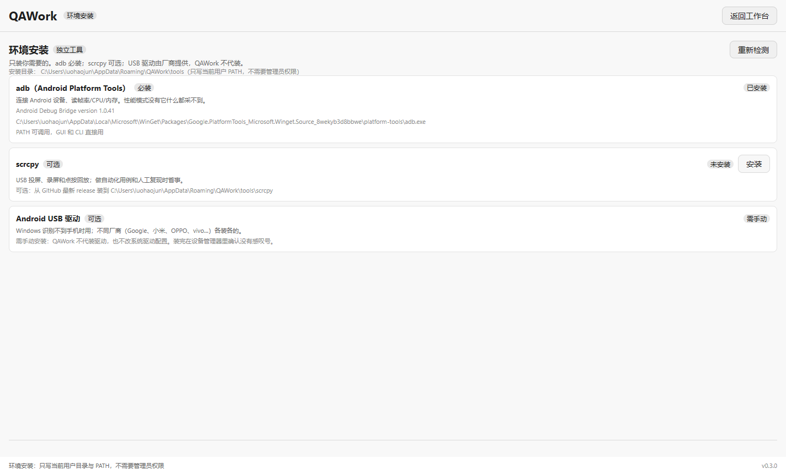

# 环境安装工具

Android 采样依赖 PC 上的 adb。QAWork 把这件事做成一个独立界面：**只装你选的**，adb 标必装，scrcpy 可选，USB 驱动明确交给厂商。

窗口入口：主界面右上角 **环境**，或 `qawork-gui.exe -setup` 直接打开。CLI 同一套逻辑：`qawork setup check|install`。



## 必装与可选

| 依赖 | 级别 | 装什么 | 不装会怎样 |
| --- | --- | --- | --- |
| **adb（Android Platform Tools）** | **必装** | Google 官方 platform-tools（Windows `adb.exe` + AdbWinApi.dll；macOS `adb`） | 列不出设备，Android 性能模式完全不可用 |
| scrcpy | 可选 | GitHub 最新 release：Windows win64、macOS arm64 | 不影响采样；只是少一个投屏/录屏/点按调试工具 |
| Android USB 驱动 | 平台相关 | Windows 厂商驱动；macOS 免驱 | Windows 设备管理器出现感叹号，adb 看不到手机；QAWork 不代装、不改驱动配置 |

"必装"只有 adb。性能采集的帧率、CPU、内存、温度全部经由 adb 读取，没有替代路径。

## 装到哪里

默认 `os.UserConfigDir()/QAWork/tools`：

- Windows：`%APPDATA%\QAWork\tools`
- macOS：`~/Library/Application Support/QAWork/tools`

```
tools/
├─ platform-tools/
│  ├─ adb(.exe)
│  └─ ...
└─ scrcpy/
   ├─ scrcpy(.exe)
   └─ ...
```

`QAWORK_HOME` 可以整体改掉这个根目录。所有文件都在当前用户目录，**不需要管理员权限**，不写 `/usr/local`、`C:\Program Files`，不改系统级环境变量。

## PATH 怎么写

- **Windows**：把对应目录追加到 **HKCU\Environment\Path**（当前用户 PATH），已存在则不重复加。
- **macOS**：把目录写进 `~/.zprofile` 的受管块（`# >>> QAWork tools >>>`），重复安装只替换这块；新开 Terminal 生效，不改 `/etc/paths`。
- 同一进程立即生效（GUI 和 CLI 都能直接用）；已经开着的终端要重开才看得到。
- 卸载：删掉 `tools` 下对应目录，再从用户 PATH（Windows 注册表 / `~/.zprofile` 受管块）里删掉那一行即可；QAWork 不会自动删 PATH。

## CLI

```powershell
qawork setup check                 # 人类可读；缺必装项退出码 2
qawork setup check -json           # 给 agent / CI
qawork setup install -id adb       # 缺 adb 才下载，已装则跳过
qawork setup install -id scrcpy
qawork setup install -id adb,scrcpy
qawork setup install -id adb -no-path   # 只落盘，不改 PATH（便携/测试）
```

安装过程的进度写 stderr，`-json` 的 stdout 只有结果，方便 Agent 解析。

## GUI

- 每行一个依赖：**必装/可选**、当前状态、版本、路径、安装按钮。
- "一键安装必装"只处理标记为必装且缺失的项（当前就是 adb）。
- Windows 驱动行没有安装按钮，只写"需手动"，避免给出一个装不了的假按钮；macOS 显示"USB 连接：免驱"。
- 安装完成后自动重新检测，主界面刷新设备。

## 已验证

- scrcpy 安装器在临时 `QAWORK_HOME` 下真实跑通（Windows）：查询 GitHub latest → 下载 v5.0.1 win64 zip → 解压到 `tools/scrcpy/scrcpy.exe`。
- adb 检测顺序：`QAWORK_ADB` → 自带 `tools/platform-tools` → PATH → `ANDROID_SDK_ROOT` / `ANDROID_HOME` → 平台常见 SDK 目录（Windows `%LOCALAPPDATA%\Android\Sdk`，macOS `~/Library/Android/sdk`、`~/Android/Sdk`）。
- 解压带路径越界防护（拒绝 `..`），单测覆盖；macOS 解压后补 `chmod +x`。
- adb 已存在时安装器直接跳过，不重复下载。
- PATH 写入：Windows 是当前用户注册表项，测试不触碰真实注册表；macOS 是 `~/.zprofile` 受管块，测试用临时 HOME。
- macOS 只做了 `GOOS=darwin GOARCH=arm64` 交叉编译与单测编译，安装器未在真实 Mac 上验收。

## 边界

- 安装器支持 **Windows amd64 与 macOS arm64**，其他平台 `AddUserPath` 返回明确错误；不支持 Linux。
- 下载走 Google / GitHub 官方地址，没有镜像加速；公司网络需要代理时先配好系统代理。
- 不校验数字签名/哈希，只依赖 HTTPS 与官方域名。要更强校验得加签名验证，当前没做。
- USB 驱动、设备端"USB 调试"开关、授权弹窗都不归 QAWork 管，文档和 UI 里都直说。
